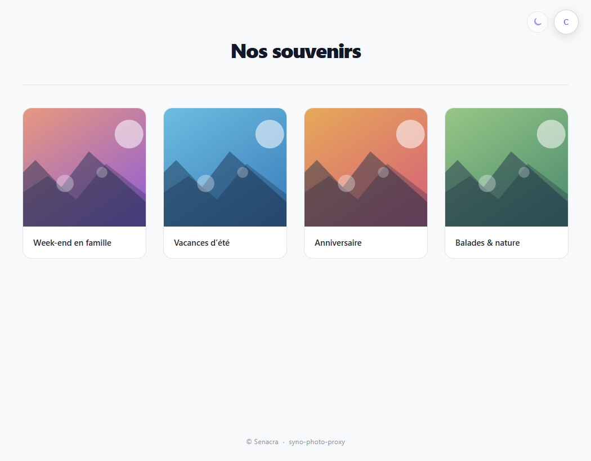
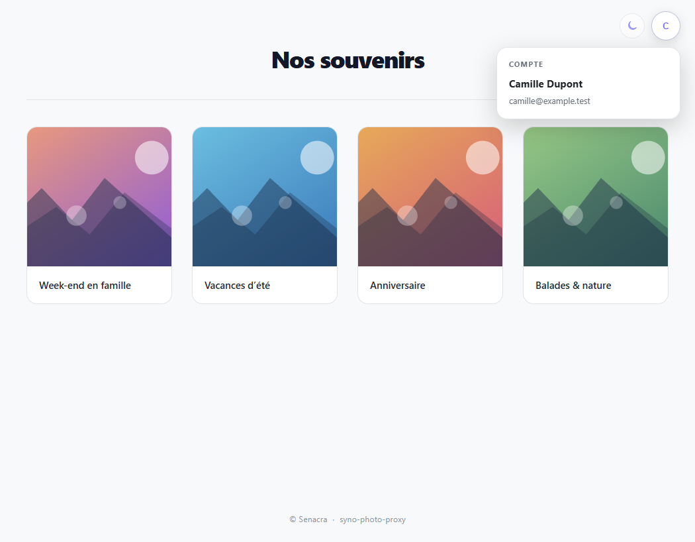
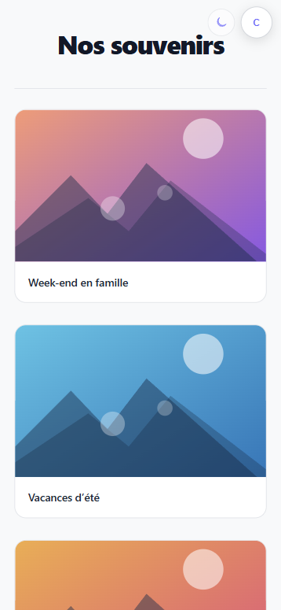
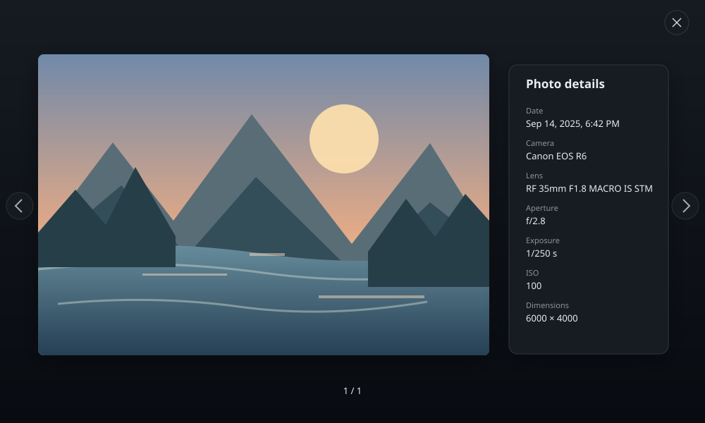

# Synology Photos BFF Proxy 📸


A lightweight web service based on a **BFF (Backend-For-Frontend)** architecture to securely expose specific photo albums from a Synology NAS on the internet, without directly exposing the NAS itself.

## 🖼️ UI Preview

The previews below use illustrative placeholder images and a fictitious account.

<p align="center">
  
  
</p>
<p align="center">
  
</p>

The fullscreen viewer can show a photo alongside its available EXIF details:

<p align="center">
  
</p>

---

## 🛡️ Security & Architecture

* **Total Isolation:** The Synology NAS hosting your photos remains completely isolated from the web. Only this proxy service (FastAPI) is publicly accessible.
* **Restricted Account** Uses a dedicated local account with minimal permissions. The system handles album sharing (including albums shared with the account without it being the initial creator) using memory-mapped IDs (`secure_xxx`).
* **Optimized Streaming:** Images and thumbnails are streamed on-the-fly from the NAS to the client with HTTP cache headers (`Cache-Control`) to reduce bandwidth and server load.
* **Photo details:** The fullscreen viewer can display available EXIF information and an OpenStreetMap map for photos with GPS coordinates.
* **Casual download deterrence:** Image context menus and drag-and-drop are disabled in the gallery. This is not access control: displayed images can still be saved by other means or captured with a screenshot.

Opening a GPS map loads Leaflet assets from unpkg.com and map tiles from OpenStreetMap tile servers. Both services receive the visitor's IP address; the map tile requests also reveal the approximate area being viewed to OpenStreetMap. No map tiles are requested for photos without GPS coordinates.

---

## 📂 Project Structure

``` text
├── main.py              # FastAPI backend, routing, and static file serving
├── synology_client.py   # Synology API wrapper (Auth, Albums, Items, Stream)
├── requirements.txt     # Python dependencies
├── .env                 # Environment configuration
└── static/              # Frontend static files
    ├── index.html       # Main HTML gallery interface
    ├── style.css        
    └── app.js           # Frontend logic (API fetch, grid rendering, lightbox)
```

---

## 🛠️ Tech Stack

* **Backend:** Python 3.10+, [FastAPI](https://fastapi.tiangolo.com/), `httpx` (asynchronous HTTP client for DSM API), `pydantic-settings`.
* **Frontend:** HTML5, CSS3 (Vanilla with native `light-dark()` support), Vanilla JavaScript.

---

## 🐳 Docker Deployment (Recommended)

A pre-built Docker image is available on the GitHub Container Registry (GHCR). You don't need to build it yourself; you can simply pull it and run it.

1. Create your `.env` file (see `.env_EXAMPLE`).
2. Create a `docker-compose.yml` file with the following content:

```yaml
version: '3.8'

services:
  syno-photo-proxy:
    image: ghcr.io/senacra/syno-photo-proxy:latest
    container_name: syno-photo-proxy
    restart: unless-stopped
    ports:
      - "8000:8000"
    env_file:
      - .env
```
3. Run

``` bash
docker compose up -d
```

## ⚙️ (Dev) Configuration & Setup

### 1. Environment Variables
Create a `.env` file in the root directory of the project (see `.env_EXAMPLE`):

``` env
nas_url=https://192.168.1.100:5001
nas_user=my_minimal_user
nas_pass=my_secure_password
allowed_albums=1,2,42
gallery_title=Our Family Memories
```

### 2. Install Dependencies
``` bash
pip install -r requirements.txt
```

### 3. Run the Development Server
``` bash
uvicorn main:app --reload --port 8000
```
Open your browser and navigate to `http://localhost:8000`.

---

## 📄 Main API Endpoints

* `GET /api/config` : Retrieves general configuration (e.g., gallery title).
* `GET /api/user` : Returns display information from trusted authentication-proxy headers, or an unauthenticated profile.
* `GET /api/albums` : Lists authorized albums masked by secure IDs.
* `GET /api/albums/{album_id}` : Returns the list of photos for a specific album.
* `GET /api/images/{item_id}` : Proxy route to securely stream thumbnails and images from the Synology NAS.

### Authentication & User Management

This application does not manage user accounts or implement authentication, authorization, or OIDC login. These features may remain outside the scope of the project: the gallery is designed to work behind an external authentication service.

A possible setup is your reverse proxy → [oauth2-proxy](https://github.com/oauth2-proxy/oauth2-proxy) → syno-photo-proxy, with oauth2-proxy delegating OIDC sign-in to an identity provider such as [Pocket ID](https://github.com/pocket-id/pocket-id) or [Keycloak](https://github.com/keycloak/keycloak).

When oauth2-proxy forwards `X-Forwarded-Preferred-Username` (or `X-Forwarded-User`) and `X-Forwarded-Email`, the gallery uses them only to display the signed-in user's name and email. They do not authenticate or authorize requests in the application. Keep the service reachable only through the trusted proxy chain, and make sure the proxy overwrites client-supplied identity headers.

---

## 📌 Roadmap (TodoList)

- [x] **Docker Containerization:** Create an optimized `Dockerfile` and `docker-compose.yml` to simplify deployment on a server or a Synology NAS (via Container Manager).
- [x] **Authentication & User Management:** Authentication and account management are intentionally delegated to an external proxy and OIDC provider; the application does not plan to manage user accounts.
- [x] **Internationalization (i18n):** Frontend available in French, English, Spanish, German, and Portuguese, with the selected language saved in the browser.
- [ ] **UI / UX Improvements:** Enable selective or batch downloading of images and enhance transitions and mobile ergonomics.
- [x] **Photo Metadata & Map:** Display available EXIF details and show an OpenStreetMap map when a photo contains GPS coordinates.

---

## 📝 License
This project is licensed under the MIT License.